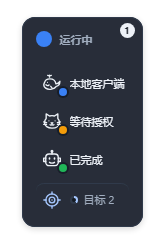
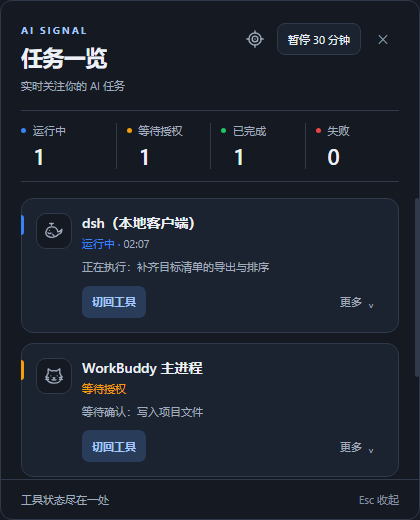
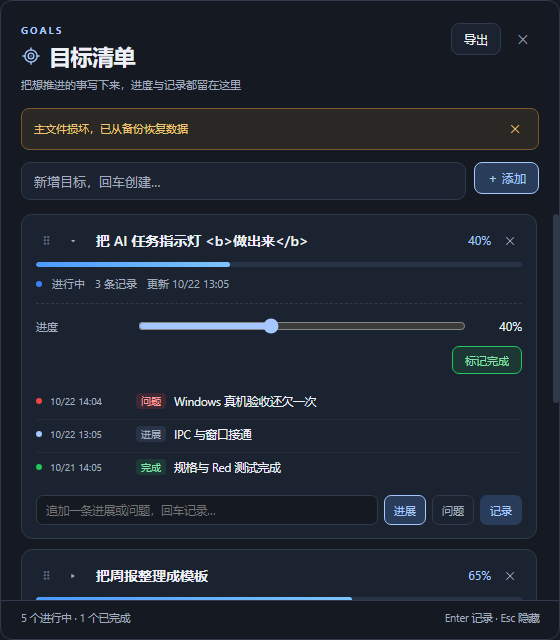

# AI 任务状态指示灯（ai-task-indicator）

Windows 桌面悬浮指示灯，用来同时盯住多个 AI 工具（WorkBuddy / DeepSeek Harness / Codex 等）的并行任务：七态颜色、托盘常驻、完成通知，点击直接回到任务现场。

另外内置一个独立的**目标清单**：长期目标、手动进度、进展 / 问题时间线、拖拽排序、Markdown 导出，悬浮灯上还会显示一行目标摘要。应用自己的进展也可以由 AI/脚本自动写入目标。

| 悬浮灯（含目标行） | 任务面板 |
|---|---|
|  |  |

---

## 功能一览

| 能力 | 说明 |
|---|---|
| **多工具监控** | 六种监控器：`process` / `log` / `webhook` / `dsh` / `sqlite` / `codex` |
| **七态指示灯** | `idle` / `starting` / `running` / `waiting` / `success` / `failed` / `unknown`，托盘 + 桌面悬浮灯同色系 |
| **悬浮灯** | 单灯或灯带；可拖到左/右/顶部自动收成点阵；有进行中目标时多一行「目标 N」+ 平均进度环 |
| **任务面板** | 点托盘/悬浮灯展开，列出每个任务的状态、耗时、最近消息、操作按钮 |
| **通知** | `waiting` / `success` / `failed` 默认弹窗 + 提示音；30s 去重；全屏时免打扰 |
| **点击跳转** | 终端/窗口/目录/日志多级降级；Web 任务可经扩展切回已打开的浏览器标签 |
| **目标清单** | 进度、时间线、完成、删除、拖拽排序、Markdown 导出，数据本地持久化 |
| **目标同步** | `goal-sync` CLI 写入收件箱，运行中的应用约 1 秒导入为时间线记录 |

技术栈刻意保持极简：**Electron + strict TypeScript + 原生 DOM + tsc**，没有 UI 框架、没有打包器；生产依赖只有 `electron` 与 `yaml`。

---

## 目录

- [它解决什么问题](#它解决什么问题)
- [快速开始](#快速开始)
- [六种监控方式](#六种监控方式)
- [配置说明](#配置说明)
- [状态与颜色](#状态与颜色)
- [悬浮灯与任务面板](#悬浮灯与任务面板)
- [通知与点击跳转](#通知与点击跳转)
- [浏览器扩展](#浏览器扩展)
- [目标清单](#目标清单)
- [开发与测试](#开发与测试)
- [验证与已知限制](#验证与已知限制)
- [文档](#文档)
- [设计出处](#设计出处)

---

## 它解决什么问题

同时跑多个 AI 任务时，你没法一直盯着每个终端：

- 任务卡在「等待授权」，你没注意，白等半小时；
- 某个任务崩了，另外几个还在跑，分不清哪个挂了；
- 想看某个任务的状态，必须切窗口 + 找对标签页。

这个应用把这些状态收到托盘图标 + 桌面小灯 + 任务面板里。

而目标清单解决另一半问题：长期想推进的事（例如「把 AI 信号灯做出来」）不该散落在便签和聊天记录里。每条目标有进度、时间线（进展 / 问题 / 完成），周五回看或导出 Markdown 都很直接；AI 完成一个开发切片后，也可以用命令自动补一条进展。

---

## 快速开始

### 环境要求

- Windows 10 / 11
- Node.js ≥ 20（仅构建/测试）；启动助手推荐 Node 24，至少 22.5（SQLite 监控会另起系统 Node 使用 `node:sqlite`）

### 安装与运行

```bash
# 1. 安装依赖
npm install

# 2a. 无窗口冒烟自检（真实 HTTP/日志/状态机，约 1–2 秒）
npm run smoke

# 2b. 用演示配置启动 GUI
npm run start:demo

# 2c. 或者用自己的配置
npm run build && npm start -- --config D:/path/to/your-config.yaml
```

日常最省事的方式是双击仓库根目录的 [`启动指示灯.cmd`](./启动指示灯.cmd)（推荐 Node 24）。它沿用 `config.local.yaml`，缺失时从桌面模板创建、缺构建产物时自动构建；启动窗口可以最小化，退出请走托盘菜单。保留整个仓库，不要只复制这一个 cmd 文件。

源码更新后：`npm run build`，再重启应用。仅检查环境可用 `node scripts/start-desktop.mjs --check`。

### 配置放在哪

首次运行会落盘一份模板到：

```
%USERPROFILE%\.ai-task-indicator\config.yaml
```

路径优先级：`--config` > `%USERPROFILE%\.ai-task-indicator\config.yaml` > `%APPDATA%\ai-task-indicator\config.yaml` > 落盘模板。

### 启动失败排查

| 现象 | 原因 | 处理 |
|---|---|---|
| `Cannot read properties of undefined (reading 'requestSingleInstanceLock')` | `ELECTRON_RUN_AS_NODE=1` 让 electron 退化成普通 Node | 用 `npm start`（自动清除） |
| `FATAL: GPU process isn't usable. Goodbye.` | 无显卡 / 远程桌面 / 虚拟机里 GPU 进程崩溃 | 用 `npm start`（自动加 `--disable-gpu` 等参数） |
| 双击能开、命令行启动失败 | 上述变量只存在于某些终端会话 | 统一走 `npm start` |
| 日志里「进程枚举子进程第 N 次重启」后任务转 `unknown` | `Get-CimInstance` 被安全策略拦截 | 正常降级，改用 `log` / `webhook` 型 |

应用日志：`%APPDATA%\ai-task-indicator\logs\ai-task-indicator-YYYY-MM-DD.log`。

> 启动器会处理两个实测踩过的环境问题：`ELECTRON_RUN_AS_NODE=1` 和 GPU 崩溃。本应用是纯 2D UI，禁用 GPU 加速没有损失；需要排查渲染问题时用 `npm start -- --enable-gpu`。

---

## 六种监控方式

配置文件的 `tasks` 数组里，每个任务用 `monitor.type` 指定监控方式：

| 类型 | 适用场景 | 信号来源 | 关键点 |
|---|---|---|---|
| `process` | 有常驻进程的任务 | `Get-CimInstance Win32_Process` | 进程名 + 命令行匹配；退出码判定；可配 `fallbackLog` |
| `log` | 往日志写输出的 CLI | 增量 tail + 正则 | 支持 `**` 通配；`failed` 优先级最高 |
| `webhook` | 自己的脚本 / CI 能主动上报 | 本地 HTTP（127.0.0.1） | token、心跳超时、`GET /api/tasks` |
| `dsh` | DeepSeek Harness 实例 | 轮询 `POST /api/session/list` | 零侵入；自动发现端口；隧道型配 `sshHost` |
| `sqlite` | 状态写在 SQLite 的应用 | 只读查询数据库 | 状态 + 新鲜度双条件；可要求进程存在 |
| `codex` | OpenAI Codex CLI | 本地 rollout 事件 | 不重放历史完成；可选审批 Hook |

### process —— 进程与命令行

```yaml
tasks:
  - id: workbuddy
    name: WorkBuddy 主进程
    enabled: true
    monitor:
      type: process
      match:
        - processNames: [node.exe, workbuddy.exe]
          cmdlineContains: [workbuddy]
      onExit:
        successExitCodes: [0]
        graceMs: 3000
      fallbackLog:
        paths: ["%USERPROFILE%/.workbuddy/logs/*.log"]
        stateOnNewLine: running
    jump:
      terminal: { type: windowTitle, match: WorkBuddy }
```

- `match` 数组之间为「或」，单个 match 内进程名与命令行子串为「与」。
- 进程消失后等 `graceMs`，再按 `successExitCodes` 判 `success` / `failed`。
- 想省内存可设 `app.processPollMode: onDemand`（每轮 spawn 一次，慢但轻）。

### log —— 日志文件

```yaml
tasks:
  - id: dsh-harness
    monitor:
      type: log
      paths: ["D:/projects/demo/**/*.log"]   # 不要只写目录
      readMode: tail
      fromEndBytes: 65536
      rules:
        - state: failed
          match: "(error|fatal|exception|failed)"
        - state: waiting
          match: "(permission request|needs?_input|请确认)"
        - state: success
          match: "(task complete|completed|done|完成)"
        - state: running
          match: "(running|executing|step [0-9]+)"
      idleAfterSilenceMs: 60000
```

- `paths` 必须指向文件或带通配符的路径；只写目录会匹配到 0 个文件。
- 正则不要写 `(?i)` 前缀（JS 不认），应用默认已忽略大小写。
- 单条正则写错只丢那一条，其余规则照常生效。

### webhook —— 主动上报

```yaml
app:
  hookPort: 17890

tasks:
  - id: remote-agent
    monitor:
      type: webhook
      listen: 127.0.0.1
      path: /hook/remote-agent
      secret: change-me-local-token
      fieldMap:
        state: $.status
        message: $.message
      heartbeatTimeoutMs: 120000
```

```bash
curl -X POST http://127.0.0.1:17890/hook/remote-agent \
  -H "Content-Type: application/json" \
  -H "x-indicator-token: change-me-local-token" \
  -d '{"status":"running","message":"开始执行"}'

curl http://127.0.0.1:17890/api/tasks   # 读取当前所有任务状态
```

强制 loopback、校验 Host、`timingSafeEqual` 比较 token、请求体上限 64KB、不返回 CORS 头。

### dsh —— 轮询 DeepSeek Harness

```yaml
tasks:
  - id: dsh-local
    name: dsh（本地客户端）
    monitor:
      type: dsh
      authority: auto              # 自动发现本机 dsh 实例
      intervalMs: 5000
    shortLabel: 本地客户端

  - id: dsh-web
    name: dsh（远端隧道）
    monitor:
      type: dsh
      authority: 127.0.0.1:13080
      sshHost: user@your-host      # 隧道型：本机密钥必然 401，需从远端取
```

- 应用会枚举监听端口、用 `~/.dsh/.credentials.yaml` 离线签 cookie，再打 `session/list`，不需要在 dsh 里装东西。
- `authority: auto` 会自动发现并跟随端口变化（SPEC-005），首次发现约 15–20 秒。
- 隧道型实例必须配 `sshHost`；密钥会缓存 30 分钟。
- 连续失败 5 次 → 转 `unknown`，浮窗隐藏该行。

### sqlite —— 读应用数据库

```yaml
tasks:
  - id: workbuddy
    monitor:
      type: sqlite
      database: D:/your-appdata/.workbuddy/workbuddy.db
      activeStatus: working
      activeWithinMs: 120000
      requireProcess:
        - processNames: [WorkBuddy.exe]
```

`activeStatus` 与 `activeWithinMs` 缺一不可：实测库里有 `status='working'` 但已静默 20 小时的遗留记录，只看状态会永远亮蓝。

### codex —— 本地 rollout 事件

```yaml
tasks:
  - id: codex
    monitor:
      type: codex
      sessionsDir: "%USERPROFILE%/.codex/sessions"
      intervalMs: 2000
      activeWithinMs: 300000
      # approvalEventsFile: ...
```

- 读取 `.codex/sessions` 的结构化 rollout；不会在启动时重放历史完成。
- 回合完成后保留绿灯，点击确认或默认十分钟到期后回到空闲；新回合重新变蓝。
- 可选 `approvalEventsFile` 配合官方 Hook，在请求审批时黄灯。安装与边界见 [Codex 授权 Hook 指南](./docs/development/codex-approval-hooks.md)。

---

## 配置说明

- **热重载**：保存配置文件即生效，无需重启；语法错误保留旧配置并气泡提示。
- **自身写回不回声**：拖动灯位置、托盘开关等自身写回不会触发「配置已重载」提示；内容没变化不写盘。
- **容错**：单个字段非法只丢该字段，非法任务项跳过，其余照常生效，并给出逐条警告。
- **示例**：
  - [`config.example.yaml`](./config.example.yaml) —— process / log / webhook
  - [`config.dsh.example.yaml`](./config.dsh.example.yaml) —— dsh / sqlite
  - [`config.desktop.example.yaml`](./config.desktop.example.yaml) —— dsh + WorkBuddy + Codex 桌面组合
  - [`config.demo.yaml`](./config.demo.yaml) —— 演示用的三个任务
- **本地私有取值**：SSH 主机、数据库路径等只放 `config.local.yaml`（已忽略）或环境变量；仓库只保留占位符。

---

## 状态与颜色

| 状态 | 颜色 | 含义 |
|---|---|---|
| `idle` | 灰 | 未开始 / 已清理 |
| `starting` | 淡蓝 | 刚发现信号，启动中 |
| `running` | 蓝（呼吸） | 正在执行 |
| `waiting` | 黄（快闪） | 等待确认 / 授权，最容易卡住 |
| `success` | 绿 | 已完成（有未读标记） |
| `failed` | 红 | 失败或等待超时 |
| `unknown` | 深灰 | 信号超时，监控源可能失联 |

**聚合优先级**：`failed > waiting > running > success > starting > idle > unknown`。任一任务失败，整个托盘灯变红。

**超时默认值**（可被 YAML `defaults` 覆盖）：

| 行为 | 默认 |
|---|---|
| `starting` 无新信号回 `idle` | 10s |
| 信号静默转 `unknown` | 60s |
| `waiting` 悬挂转 `failed` | 30min |
| `success` 自动清理 | 10min |
| 日志静默转 `idle`（`idleAfterSilenceMs`） | 60s |

**几个关键约定**

- 失败不会自动变绿，必须真实重试信号或显式重置。
- 完成确认后同一完成事件不会再次点亮（确认水位）。
- 浮窗只显示「活着」的行：`failed` / `unknown` 会被隐藏，但总灯仍会反映异常。
- 当可显示任务 ≥ 2，或存在进行中目标时，使用灯带形态；否则缩成单灯。

---

## 悬浮灯与任务面板

### 悬浮灯

| 位置 | 形态 | 样子 |
|---|---|---|
| 桌面任意处，可显示任务 ≥ 2 | 常规灯带 | 总灯在上，下面每行「小灯 + 短标签」 |
| 桌面任意处，可显示任务 < 2 且没有进行中目标 | 单灯 | 一颗圆点，干扰最小 |
| 贴屏幕左/右边缘 24px 内 | 竖排点阵 | 只剩一列圆点，不带文字 |
| 贴屏幕顶部 24px 内 | 横排点阵 | 只剩一排圆点，不带文字 |

把灯拖到屏幕左/右/上边缘松手，约 0.2 秒后自动收成点阵；拖回桌面中间恢复灯带。**不需要配置**。贴底部不变形态；跨屏摆放不算贴边，屏幕边外推仍算。

有进行中目标时，灯带底部会多一行：**目标图标 + 平均进度环 + `目标 N`**，点击打开目标窗口；全部完成后该行消失。

| 贴侧边：竖排点阵（52×205） | 贴顶部：横排点阵（201×56） |
|---|---|
|  |  |

> 以上截图均由 `scripts/readme-shots.cjs` 使用当前 `dist/renderer` 的真实渲染生成（fixture 数据，不读本机配置/会话）。

### 任务面板

点击托盘图标或悬浮灯展开，宽度 420 DIP、最大高度 520 DIP，列出每个任务的状态、耗时、最近消息与可用操作（切回工具 / 日志 / 目录 / 重新监控 / 标记已读）。面板跟随系统深浅色，失焦自动收起。

---

## 通知与点击跳转

**通知**：默认对 `waiting` / `success` / `failed` 弹窗 + 提示音；30 秒内同一任务重复完成只提醒一次并显示 `×N`；全屏应用时默认免打扰（仅托盘变色）。可分别关闭 `notify.popup` / `notify.sound`。

**点击跳转**：点击任务行优先回到任务现场，任何一级失败都自动降级，**永不抛异常**。

配了 `openUrl` 的 Web 任务：

```
① 浏览器扩展精确切标签 → ② CDP（可选，专用调试实例）→ ③ 按窗口标题聚焦 → ④ 新开标签页
```

没配 `openUrl` 的桌面任务：

```
L1 spawn 型：执行你配置的命令（如 wt.exe new-tab -d <cwd>）
L2 窗口级聚焦：先最小化 → 恢复 → SetForegroundWindow（以 GetForegroundWindow 真实结果为准）
L3 目录兜底：explorer.exe <cwd>
L4 日志兜底：用 notepad 或指定程序打开日志
L5 全部失败：返回失败，只记日志
```

**已知限制**

- 能精确切回**浏览器里已打开的标签页**（配扩展）；不能切到 Windows Terminal 的某个历史标签页（系统无 API）。
- 窗口标题只能作兜底：重名窗口、程序自行改标题都会影响匹配。
- 本机没装 Windows Terminal 时 `wt.exe` 不存在，L1 会被跳过；托盘菜单「重新探测终端」可刷新。
- 后台窗口恢复覆盖隐藏 / 最小化场景（SPEC-020）；点击时延已优化（SPEC-022）；点击后窗口关闭行为见 SPEC-023。

---

## 浏览器扩展

如果只配 `openUrl`，每点一次就会新开一个标签页。Chrome 136 起默认用户数据目录不再允许 `--remote-debugging-port`，所以项目附带一个极小的扩展，用 `chrome.tabs.update` + `chrome.windows.update` 操作你日常浏览器里的真实标签。

安装（约 10 秒）：

1. 打开 `chrome://extensions`
2. 开启「开发者模式」
3. 把 [`extension/`](./extension/) **整个文件夹**拖进页面

然后给任务加：

```yaml
jump:
  openUrl: http://127.0.0.1:13080
  openUrlViaExtension: true
```

指示灯在 `127.0.0.1:17891` 起一个仅 loopback 的桥接服务，扩展长轮询取指令、回报结果；没装扩展时自动退回「新开标签页」。详见 [`extension/README.md`](./extension/README.md)。

---

## 目标清单

独立的「目标清单」窗口（SPEC-024 ~ SPEC-027），与 AI 任务状态互不影响：



- **入口**：托盘右键菜单 →「目标清单…」；或任务面板标题栏的目标图标。
- **悬浮灯**：有进行中目标时，灯带底部显示「目标 N」+ 平均进度环；点击打开目标窗口。
- **每条目标**：标题（点击可改）、0–100% 手动进度、状态（进行中 / 已完成）。
- **时间线**：追加「进展 / 问题」记录（带时间、只追加、可删除）；「标记完成」会把进度置 100% 并自动记一条完成记录。
- **拖拽排序**：拖动卡片左侧把手，在同一分组内上下移动；顺序持久化，导出顺序同步变化。
- **已完成**：沉到列表底部折叠区，仍可回看与删除。
- **导出**：右上角「导出」把全部目标与记录写成 Markdown（默认 `goals-YYYY-MM-DD.md`）。
- **窗口**：560×640、无边框置顶、失焦**不**隐藏；`Esc` / `✕` 只隐藏，下次打开内容还在。焦点在输入框里时 `Esc` 只退出输入焦点，草稿与窗口都保留（SPEC-033）；推送到达只做 keyed 增量更新、不重建卡片 DOM（SPEC-038），草稿、焦点、滚动位置、IME 组合与两段式删除确认态都不被打断（SPEC-031/038）。
- **数据**：`%APPDATA%\ai-task-indicator\goals.json`（与 `config.yaml` 分开）；防抖写盘、退出 flush、原子替换；损坏时保留原文件并尝试 `.bak`。

### 开发进展自动同步

AI / 开发者完成一个切片后，不需要手动点 UI：

```bash
node scripts/goal-sync.mjs --goal "AI信号灯软件开发" --kind progress --text "SPEC-0NN …"
```

它把一行 JSON 追加到 `goal-inbox.jsonl`，运行中的应用约 1 秒导入为目标时间线的一条记录（未运行则下次启动导入）。`--kind issue` 记为问题；失败行落 `.failed.jsonl`。实现见 [SPEC-027](./docs/specs/027-goal-progress-sync.md)。


不做周视图、子任务、提醒、云同步、JSON 导入导出（见 [SPEC-024](./docs/specs/024-goals.md)、[SPEC-025](./docs/specs/025-overlay-goals-row.md)、[SPEC-026](./docs/specs/026-goal-reorder.md)、[SPEC-027](./docs/specs/027-goal-progress-sync.md) 非目标）。

---

## 开发与测试

```bash
npm run dev            # 编译 + 启动开发模式
npm run build          # tsc 编译 main + renderer，并复制静态资源
npm run typecheck      # 三份 tsconfig：main + renderer + test
npm test               # 单元测试（vitest）
npm run smoke          # 无窗口端到端冒烟，真实 IO
npm run check:ui       # 隐藏 Electron 渲染夹具（布局/主题/长列表）
npm run check:goals    # 真实 GoalsWindow + preload + IPC + Store 集成
npm run start:demo     # 演示配置启动
npm run dist           # 打包 Windows NSIS 安装包
```

**目录结构**

```
src/
  shared/       类型契约、IPC 契约、常量（主进程与渲染层共用）
  main/         主进程：托盘、悬浮窗、面板、状态仓库、通知、跳转、目标清单
    monitors/   六种监控器 + 规则引擎
  preload/      contextBridge 白名单
  renderer/     悬浮灯 / 任务面板 / 目标窗口（classic script，无 import）
test/           单元测试
scripts/        启动、冒烟、UI 夹具、目标同步 CLI
docs/           开发流程、规格、验证记录
extension/      精确切标签的 Chrome 扩展
```

### specTDD 开发流程

迭代遵循 **规格 → 失败测试（Red）→ 最小实现（Green）→ 重构（Refactor）→ 回归与真机验收**：

- 从[文档入口](./docs/README.md)和[开发流程](./docs/development/spec-tdd.md)开始；
- 用[规格模板](./docs/specs/_template.md)建立变更、登记到[迭代索引](./docs/specs/README.md)；
- 按[测试与验收规范](./docs/development/testing.md)执行；人与 AI 都遵循 [AGENTS.md](./AGENTS.md)；
- 历史失败与接管基线见[验证记录](./docs/development/baseline-validation.md)与 [000-baseline](./docs/specs/000-baseline.md)。

当前流程靠文档约定与评审执行，尚未配置 CI 门禁；仓库也暂未提交 lockfile。

### 当前验证快照

截至 2026-10-22（Windows 10/11、Node 24、Electron 33）：

| 检查 | 结果 |
|---|---|
| `npm run typecheck` | 通过 |
| `npm test -- --maxWorkers=2 --minWorkers=1` | **64 files / 928 tests passed** |
| `npm run build` | 通过 |
| `npm run smoke` | 22 项断言全部通过 |
| `npm run check:ui` | 31 个真实 Electron 渲染场景 PASS |
| `npm run check:goals` | 目标窗口真实 IPC 集成 PASS |
| Windows 真机 | 目标窗口、悬浮灯目标行、拖拽排序均经用户确认；SPEC-002 的三工具并行矩阵仍为 `verifying` |

测试数量是当次快照，不代表历史版本。

---

## 验证与已知限制

**想确认它真的在工作**，按顺序试：

1. 跑一个会写日志的任务，让日志出现 `error`，灯应变红；
2. 任务失败时应有弹窗 + 提示音（可分别关闭）；
3. 用 `remote-agent` 的 curl 发 `running` → `failed`，观察灯与通知；
4. 配一个 process 型任务指向临时进程（如 `ping -t`），关掉它，`graceMs` 后应变红；
5. 让日志高频输出 `error`，确认 30 秒内只通知一次并显示 `×N`；
6. 打开目标窗口，加一条目标、拉进度、记一条进展、拖拽排序、导出 Markdown；
7. 运行 `goal-sync` 写一条进展，确认目标时间线约 1 秒内出现。

**已知限制**

- 不能切到 Windows Terminal 的某个历史标签页（系统无 API）；浏览器标签可以靠扩展切。
- 窗口标题匹配只是兜底；重名窗口会影响结果。
- 托盘/悬浮灯/通知/焦点/DPI/多屏等桌面行为必须 Windows 真机验收，单元测试不能替代。
- 目标数据损坏时会隔离原文件并尝试 `.bak`，仍可能丢失最近一次未落盘的改动（防抖窗口内崩溃）。
- 目标窗口位置不持久化；收件箱失败行只写 `.failed.jsonl`，没有 UI 查看。

---

## 文档

| 文件 | 内容 |
|---|---|
| [docs/README.md](./docs/README.md) | **开发入口**：流程、规格索引、基线、历史资料 |
| [docs/development/spec-tdd.md](./docs/development/spec-tdd.md) | specTDD 阶段、关卡、完成门槛 |
| [docs/development/testing.md](./docs/development/testing.md) | 测试分层、命令、Windows/云端边界 |
| [docs/development/desktop-validation.md](./docs/development/desktop-validation.md) | 三工具桌面验收清单与边界 |
| [docs/development/codex-approval-hooks.md](./docs/development/codex-approval-hooks.md) | Codex 审批黄灯 Hook |
| [docs/specs/README.md](./docs/specs/README.md) | 规格与迭代索引 |
| [docs/specs/000-baseline.md](./docs/specs/000-baseline.md) | 当前工程基线、不变量、代码/测试入口 |
| [docs/specs/024-goals.md](./docs/specs/024-goals.md) ~ [027](./docs/specs/027-goal-progress-sync.md) | 目标清单、悬浮灯目标行、拖拽排序、进展同步 |
| [docs/research/](./docs/research/) | 目标功能开源先例调研与 UI 对照图 |
| [docs/design-decisions.md](./docs/design-decisions.md) | 历史决策台账（外部同步副本） |

> `design-decisions.md` 与 `round*.md` 是仓库外 `../docs` 的同步副本；新流程、规格和验证记录直接在本仓库维护。

---

## 设计出处

本项目**未 fork 任何外部项目**。AI 监控方向最初检索了 26 个候选（见 [`docs/01-PRD.md`](./docs/01-PRD.md) 第 8 节），没有同时满足「Windows + 托盘 + 悬浮灯 + 多任务 + 多监控方式」的现成项目；托盘、置顶、通知直接使用 Electron 官方 API。

借鉴过的设计（均 MIT）：

- [`accessd/tmux-agent-indicator`](https://github.com/accessd/tmux-agent-indicator) —— hook 驱动的事件 → 状态映射
- [`ru-gong/agent-beacon`](https://github.com/ru-gong/agent-beacon) —— 状态 JSON 文件协议
- [`carlbuu/ai-status-light-esp32`](https://github.com/carlbuu/ai-status-light-esp32) —— 状态优先级与多任务表达

目标清单方向另做了开源调研（见 [`docs/research/`](./docs/research/)）：TodoPop 的菜单栏交互、DeskTodo 的 Windows 托盘小窗工程细节、TO-DO-Panel 的 Electron 分层、todo.txt 的纯文本模型；只借鉴交互与可靠性做法，不复制代码。

## License

MIT
