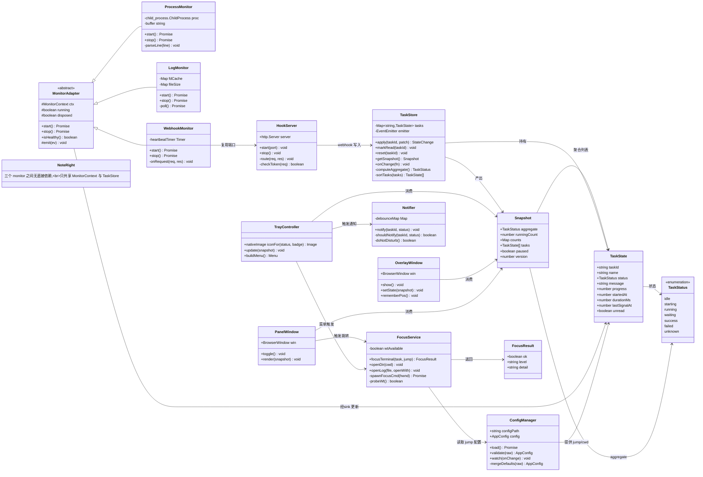
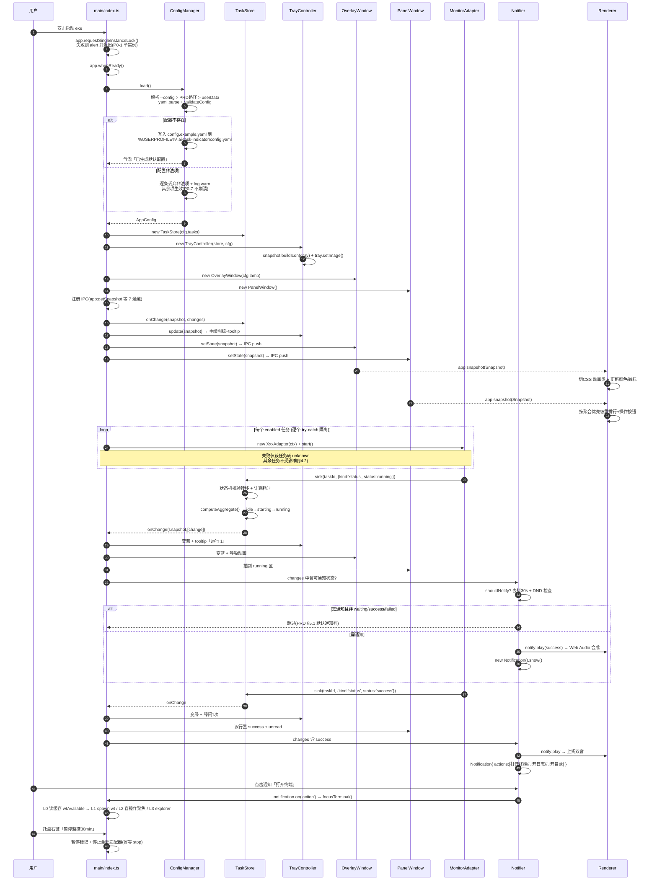
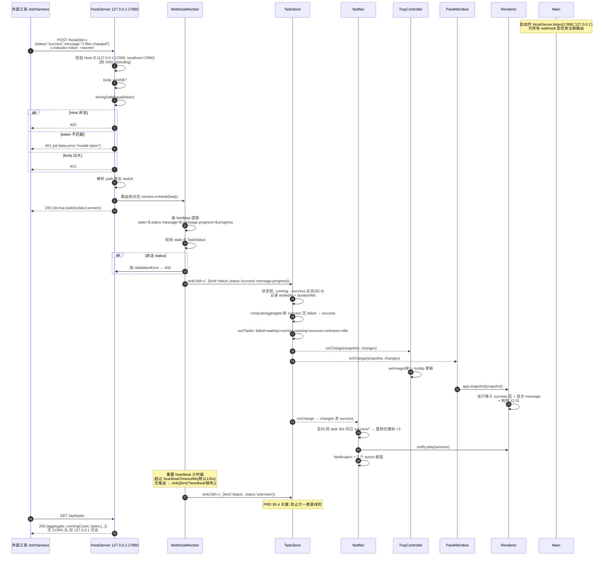
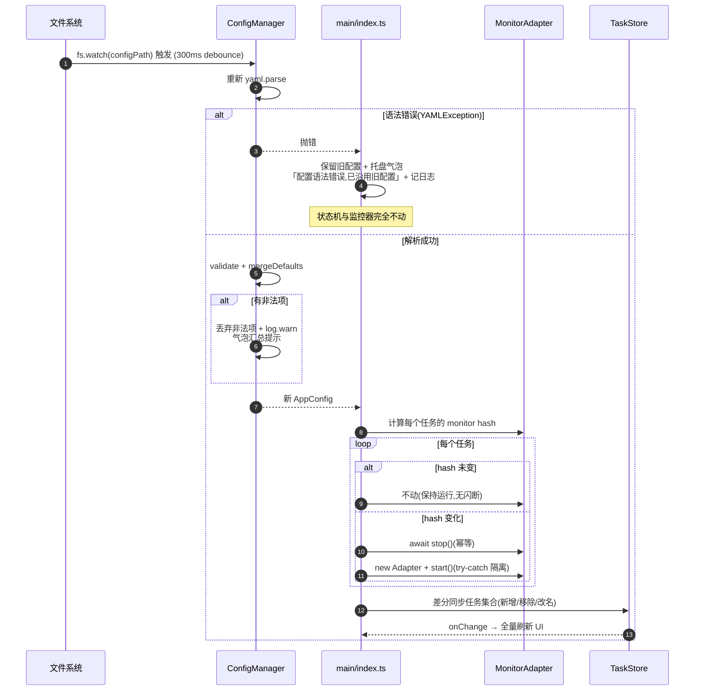
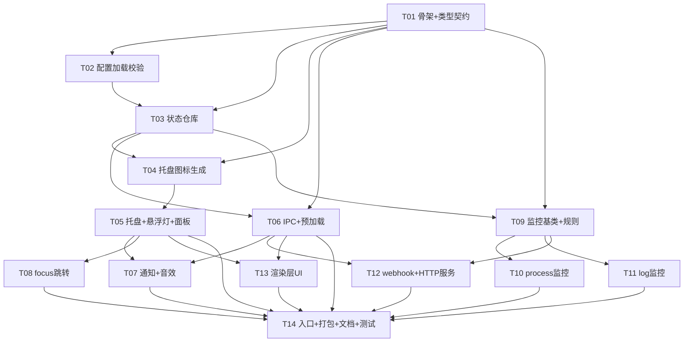

# AI 任务状态指示灯 — 系统架构设计

> **历史文档提示**：本页保留初版架构及理由，不代表当前所有模块和验证状态。后续开发先读[当前基线](specs/000-baseline.md)和[specTDD 流程](development/spec-tdd.md)，再核对相关代码与后续决策。

> 文档版本：v1.0｜撰写人：高见远（架构师）｜日期：2026-10-12
> 上游输入：`docs/01-PRD.md`（许清楚）｜POC 实测：`docs/03-POC-REPORT.md`
> 状态：可施工（工程师可照此直接开工）

---

## 0. 架构决策摘要（结论先行）

| # | 决策 | 理由（关键证据） |
| --- | --- | --- |
| **D1** | **渲染层不引入 React/Vue/Tailwind，用原生 TypeScript + DOM** | 悬浮灯（28px 圆点）+ 任务列表（≤20 行）是**静态结构、局部更新**场景。PRD §0 选React 是基于「团队栈复用」，但本项目渲染层无组件复用需求，引入 React 只增3 个依赖与构建复杂度。**全项目保持 0 UI 框架依赖，打包体积与启动速度双赢。** |
| **D2** | **构建不用 Vite，用 `tsc` 直接编译** | 主进程与预加载是纯 Node 代码，无需打包器；渲染层是 3 个静态文件，无 import 需求。`tsc` 足够，可省掉 `vite.config` + 3 个插件的维护面。 |
| **D3** | **`process` 监控器用「长驻 PowerShell 子进程 + 逐行 JSON 流」** | POC 实测：`wmic` 被拉黑/超时；`tasklist` 无命令行；**只有 `Get-CimInstance Win32_Process` 能同时拿到 ProcessId+Name+CommandLine**。且实测进程创建有~2.2s 固定开销 → 每 3s 轮询一次 spawn 绝不可行，必须长驻。 |
| **D4** | **`focusTerminal` 是多级降级链，不是"精确跳转"** | POC 实测本机**未安装 Windows Terminal**；且 WT CLI 只有 `focus-tab`(当前页)/`new-tab`，**无 `activate tab N`** → 切到指定历史标签页**做不到**。窗口级聚焦可行，页级不可行。降级链终点是 `explorer.exe`（实测 100% 可靠）。 |
| **D5** | **提示音用渲染层 Web Audio 实时合成，不打包音频文件** | PRD Q5 假设用系统默认通知音，但 §5.1 要求 waiting/success/failed **三种不同音效** → 系统音做不到。Web Audio 合成零资源、零版权、零分发体积，且能精确实现「上扬双音/低沉双音/短促叮」。系统音作为降级兜底。 |
| **D6** | **托盘图标用 `nativeImage` + 内置 5×7 点阵字模实时绘制** | 纯代码生成，无 21 张 PNG 资源文件（PRD §7.1 方案），任意状态色/任意数字徽标都能画，tray 换图零 IO。 |
| **D7** | **配置路径：`%USERPROFILE%\.ai-task-indicator\config.yaml`，支持 `--config` 覆盖** | 沿用 PRD §6 的路径（用户可手改、可放 dotfiles），`--config` 供多实例/测试。加载路径优先级：`--config` > PRD 路径 > `app.getPath('userData')/config.yaml`（首次运行自动落盘模板）。 |
| **D8** | **状态仓库是唯一数据源，主进程持有，渲染层无状态** | 单一数据源杜绝双写不一致。渲染层是纯订阅者（IPC push），可随时 `webContents.reload()` 恢复。 |

---

## 1. 实现方案与框架选型

### 1.1 技术栈

| 层 | 选型 | 说明 |
| --- | --- | --- |
| 运行时 | `electron` ^33 | Tray / BrowserWindow / Notification / autoLaunch 全官方 API |
| 语言 | `typescript` ^5.6（`strict: true`） | |
| 构建 | `tsc`（主进程 + 预加载）+ **静态复制**（渲染层） | 见 D2 |
| 打包 | `electron-builder` ^25（NSIS） | PRD D5 |
| 配置解析 | `yaml` ^2.5 | |
| 测试 | `vitest` ^2 | |
| 日志 | `electron-log` ^5（可选，失败降级 console） | |
| UI | **原生 TS + CSS**（无框架、无 Tailwind、无 MUI） | 见 D1 |

### 1.2 进程职责划分

```
┌─────────────────────────────────────────────────────────────┐
│ Main Process (Node)                                          │
│  · 唯一数据源 TaskStore                │
│  · 5 个监控适配器（进程隔离）                                   │
│  · 本地 HTTP 服务（webhook + 只读 API）                        │
│  · Tray / Overlay 窗口 / Notification / focus 跳转│
│  · 不渲染任何业务 UI（仅两个 BrowserWindow 容器）                │
└───────────────┬─────────────────────────────┬───────────────┘
                │ IPC (contextBridge 白名单)      │
┌───────────────▼─────────────────────────────▼───────────────┐
│ Renderer (Chromium)  ×2 实例                                 │
│  overlay 实例：悬浮灯 28px，transparent，无焦点                 │
│  panel  实例：380px 任务列表，frameless                       │
│  职责：渲染 + Web Audio 音效合成 + 发送用户操作                 │
│  【无业务逻辑、无状态】——  状态全部来自 IPC push│
└─────────────────────────────────────────────────────────────┘
```

**关键决策**：
- **preload 用 `contextBridge.exposeInMainWorld` 白名单暴露 5 个方法**，不open nodeIntegration。渲染层是 `file://` 加载的本地可信页面，但依然走白名单以防配置注入。
- **悬浮灯与任务列表合并为同一个 BrowserWindow？**→ **否**。悬浮灯要 `transparent: true` + `focusable: false` 常驻置顶；面板要 `frame: false` 但可交互。Electron 的 `transparent` 窗口在 Windows 上强制禁用 GPU 合成加速，混用会导致列表滚动掉帧。**拆两个窗口**。

### 1.3 悬浮置顶灯实现

| 需求 | 实现 | 备注 |
| --- | --- | --- |
| 无边框 | `frame: false` | |
| 透明 | `transparent: true` + `backgroundColor: '#00000000'` | |
| 置顶 | `alwaysOnTop: true` + `setAlwaysOnTop(true, 'screen-saver')` | 用 `screen-saver` 级别最高，全屏游戏也不被盖 |
| 不抢焦点 | `focusable: false` + `skipTaskbar: true` | |
| 鼠标穿透 | `setIgnoreMouseEvents(true, { forward: true })` | 对应 PRD `lamp.clickThrough` |
| 拖拽 | `-webkit-app-region: drag`（CSS 即可，无需 IPC） | 但灯要同时可点击 → 拖拽区与点击区分离 |
| 位置记忆 | 监听 `moved` 事件 → 写回配置（debounce 500ms） | |
| 动画呼吸 | 渲染层 CSS `@keyframes` | 呼吸/快闪全在 CSS，避免 IPC 频繁触发 |
| 常驻不被遮挡 | 另加 `setVisibleOnAllWorkspaces(true, { visibleOnFullScreen: true })` | |

> **为何不用 `nativeWindow` 模块**：PRD 未指定。Electron 的 `BrowserWindow` 组合参数已完全满足，引入 `native-window` 原生模块会破坏"零原生依赖"（且 D3 已明确规避原生模块路线）。

### 1.4 托盘图标动态着色（D6 详细）

**方案：代码内嵌 16×16 / 32×32 圆点位图模板 + 5×7 数字点阵字模 → 运行时按状态色重绘 → `nativeImage.createFromBuffer(PNG)`。**

```
托盘图标 =圆点(直径 9px @16px 尺寸) + 可选右上角 running 数量徽标
颜色     = TaskStatus → STATUS_COLOR 单一映射（§8.1）
数字     = 内置 5×7 点阵字模(0-9 + '+')
```

**为什么不用 PRD §7.1 的「预生成 21 张 PNG」**：
- 21 个二进制文件增加仓库体积与打包体积；
- 数量徽标是 0~99+ 动态的，PNG 组合爆炸；
- 代码绘制约 80 行，一次性成本，可测试（`expect(getPixel(0,0)).toBe(...)`）。

**为什么不用 SVG + dataURL**：`nativeImage.createFromDataURL` **不支持 SVG**（Electron 官方限制，只支持 PNG/JPEG dataURL），所以 SVG 模板方案**不可行** —— 这一点在此明确确认，避免工程师走弯路。

**实现路径**：`nativeImage.createFromBuffer()` 需要 PNG/JPEG 编码数据。Node 内置 `zlib` 可自己写最小 PNG 编码器（`zlib.deflateSync` + CRC32，约 40 行）。**备选**：直接用 `nativeImage.createFromBitmap(buffer, {width, height})` —— Electron 提供该 API，**直接吃 raw BGRA 像素缓冲，零编码**。✅ **采用 `createFromBitmap`**，无需任何编码代码。

### 1.5 通知与音效（D5 详细）

| 项 | 实现 | 降级链 |
| --- | --- | --- |
| 弹窗通知 | 主进程 `new Notification({ title, body, actions })` + `show()` | 不可用时 → 托盘 balloon |
| 通知点击 | `notification.on('click')` → `focusTerminal()` | — |
| 通知按钮 | `actions: [{ type: 'button', text }]` → `notification.on('action')` | Windows 上最多 3 个（PRD §7.4） |
| **音效** | **渲染层 Web Audio 合成**：OscillatorNode + GainNode 包络 | ① Web Audio（首选，0延迟）→ ② 系统提示音 `[System.Media.SystemSounds]::Asterisk.Play()` → ③ 静音 |
| 全屏免打扰 | `screen.getDisplayNearestPoint` + 焦点窗口 rect 判定 | 拿不到就按「不打扰」处理（保守） |

**音效合成参数表**（PRD §5.1 要求三种不同音）：

| 状态 | 音色 | 合成参数 |
| --- | --- | --- |
| `waiting` | 短促「叮」 | 880Hz 正弦，80ms 起音 + 200ms 衰减，音量 0.25 |
| `success` | 上扬双音 | 660Hz→990Hz 各 120ms，间隔 60ms，音量 0.3 |
| `failed` | 低沉双音 | 320Hz→220Hz 各 180ms，间隔 80ms，音量 0.35 |
| `unknown` | 极轻单音 | 440Hz，60ms，音量 0.15（P1，仅托盘） |

> **决策说明**：AudioContext 必须在用户手势后 `resume()`。Electron 渲染层无此限制（可自动播放），但为稳妥在 `DOMContentLoaded` 时先 `resume()` 一次。

### 1.6 状态管理方案（D1 详细）

```ts
// src/main/store.ts —— 主进程唯一数据源
class TaskStore {
  private tasks: Map<string, TaskState>;
  private snapshot: Snapshot;          // 聚合结果，缓存
  private emitter: EventEmitter;

  apply(taskId: string, patch: TaskPatch): StateChange | null;  // 唯一的写入口
  getSnapshot(): Snapshot;                                    // 读
  onChange(fn: (s: Snapshot, c: StateChange[]) => void): void; // 订阅
}
```

**渲染层状态**：`AppState { snapshot: Snapshot | null, expanded: boolean }`，收到 IPC push 后整体重渲染。任务数 ≤ 20，整表重绘成本可忽略，**不做虚拟滚动、不做增量 diff**（过度设计）。列表 DOM 更新走「key = taskId → 复用节点，只改 textContent/class」的轻量 patch，避免闪烁。

### 1.7 配置解析（D7 详细）

```ts
// 加载优先级
1. CLI --config <path>          （多实例 / 测试用）
2. %USERPROFILE%\.ai-task-indicator\config.yaml   （PRD §6 路径，用户手改）
3. app.getPath('userData')/config.yaml            （fallback）
4. 都不存在 → 写入 config.example.yaml 内容到路径 2，并气泡提示「已生成默认配置」
```

- **`yaml` 包**解析 → `validateConfig()` 做结构 + 语义校验；
- **非法项不崩溃**（PRD P0-7）：逐条 try-catch，非法项丢弃 + `log.warn` + 托盘气泡汇总提示，其余项照常生效；
- **热重载**（P1-2）：`fs.watch(configPath)` + 300ms debounce；语法错误 → **保留旧配置** + 气泡提示；语义变更（任务增删）→ 差分重启受影响监控器，未变动的保持不动。

---

## 2. POC 实测结论（最高优先级项）

> 完整报告见 `docs/03-POC-REPORT.md`。此处只给结论。

### 2.1 Windows Terminal 标签页定位能做到什么程度

| 目标 | 能否做到 | 实测依据 |
| --- | --- | --- |
| 枚举所有顶层窗口 + 拿真实 HWND | ✅ **能** | 实测 16/16 窗口全部拿到 HWND |
| 定位 Windows Terminal 窗口 | ✅ **能** | 按窗口类名 `CASCADIA_HOSTING_WINDOW_CLASS` 判定，比进程名可靠 |
| 把已有终端窗口带到前台 | ✅ **能**（窗口级） | `[文档]` 需 `ShowWindow+BringWindowToTop+SetForegroundWindow+AttachThreadInput` 组合 |
| 在 WT 指定窗口**新建标签页**并跳到目录 | ✅ **能** | `wt -w <name> new-tab -d <cwd>` |
| **切换到 WT 某个已有历史标签页** | ❌ **不能** | WT CLI 只有 `focus-tab`(当前页) / `new-tab`，**无 `activate tab N`** |
| 聚焦 conhost / PowerShell 独立控制台 | ⚠️ 仅标题模糊匹配，不可靠 | 实测标题有重复（`计算器`×2、 `未命名-Notepad3`×2），且任意程序可改标题 |
| 打开项目目录 / 日志文件 | ✅ **能，100% 可靠** | 实测 explorer 与 start 均成功产生新窗口 |

**本机实测：未安装 Windows Terminal**（`wt.exe` 未找到、Appx 未安装、进程数 0）。这恰好证明 **`wt.exe` 存在性必须探测**，不能假设。

### 2.2 `focusTerminal` 降级链（结论落地）

```
L0  启动时探测一次 wt.exe（where.exe wt.exe），结果缓存；托盘菜单可「重新探测终端」手动刷新
    ↓ 不存在则跳到 L3
L1  spawn 型（首选，零延迟级开销）
      wt.exe -w <windowName> new-tab -d <cwd>     ← 复用已有 WT 窗口
      wt.exe -d <cwd>                            ← 无窗口则新建
L2  窗口级聚焦（异步 fire-and-forget，5s 超时）
      盲操作：ShowWindow(SW_RESTORE) → AttachThreadInput → BringWindowToTop → SetForegroundWindow
      子进程实现：powershell -NoProfile -Command "<P/Invoke>"（不查前台窗口，规避 foreground lock 依赖）
      备选实现：powershell + WScript.Shell.AppActivate '<title>'（更轻，纯 COM）
    ↓ 失败
L3  目录兜底：spawn explorer.exe <cwd>       ← 实测 100% 可靠，终点保证
L4  日志兜底：spawn notepad.exe <logFile>（显式指定，不用系统关联）
    ↓ 全失败
    记日志 + 托盘气泡「无法定位终端」，绝不抛异常
```

**关键工程结论（POC §6 实测）**：`powershell` 比 `cmd` 慢约 **1482ms**（沙箱固定开销 2.2s 背景下测得；真实桌面约 250-600ms vs 20-60ms）。因此 **L1 优先直接 spawn，L2 才用powershell**，且 L2 必须异步不阻塞 UI。

**沙箱未能实测部分**：`SetForegroundWindow` / `AttachThreadInput` / `AppActivate` 的直接调用被沙箱安全策略禁用（`Add-Type`/`csc`/`Reflection`/`COM` 全封）。**但架构已通过「盲操作 + 不依赖前台查询 + 多级降级到实测 100% 可靠的 L3」把不确定性完全吸收，不影响可交付性。**

### 2.3 另一项关键 POC 结论：process 监控的数据源

| 方案 | 实测 | 判定 |
| --- | --- | --- |
| `wmic process get CommandLine` | 超时 + 被安全策略拉黑 | ❌ 排除 |
| `tasklist /fo csv` | 323 行，**无命令行** | 仅够 processNames |
| `Get-Process` | 有 Id+Name，**无命令行** | 不满足 |
| **`Get-CimInstance Win32_Process`** | **103KB JSON，ProcessId+Name+CommandLine 齐全** | ✅ **唯一可行** |

→ 决定 D3：长驻 PowerShell 子进程 + 逐行 JSON 流。

---

## 3. 文件列表（26 个源文件）

```
ai-task-indicator/
├── package.json                     # 依赖 + scripts(dev/build/dist/test)
├── tsconfig.json                    # 主进程 + preload 编译配置
├── tsconfig.electron.json           # 渲染层编译配置(含 DOM lib)
├── electron-builder.yml             # NSIS 打包配置
├── config.example.yaml              # 配置模板(= config.schema.md 的可执行版)
├── README.md                        # 安装/使用/打包/三类监控接入说明(PRD D4/D6)
├── docs/
│   ├── 01-PRD.md                    # (上游)
│   ├── 02-ARCHITECTURE.md# 本文件
│   └── 03-POC-REPORT.md             # POC 实测报告
├── poc/                             # 已完成的 POC 脚本(6 个,保留作回归)
│   ├── poc-2-empirical.ps1
│   ├── poc-3-refine.ps1
│   ├── poc-4-spawn-cost.ps1
│   ├── poc-5-baseline-check.ps1
│   └── poc-6-process-enum.ps1
├── src/
│   ├── main/
│   │   ├── index.ts                 # 入口: 单实例锁/启动顺序/生命周期/退出
│   │   ├── store.ts                 # ★唯一数据源: 状态机/聚合/排序/变更广播
│   │   ├── config.ts                # YAML 加载/校验/热重载/默认值合并
│   │   ├── tray.ts                  # 托盘图标装配/菜单/tooltip/点击事件
│   │   ├── overlay.ts               # 悬浮置顶灯窗口(透明/无焦点/拖拽/位置记忆)
│   │   ├── panel.ts                 # 任务列表面板窗口(380px/排序/操作按钮)
│   │   ├── ipc.ts                   # IPC 通道注册(主进程侧)
│   │   ├── notify.ts                # 通知 + 去抖节流 + DND + 音效调度
│   │   ├── focus.ts                 # ★focusTerminal 降级链(§2.2)+ jump 解析
│   │   ├── snapshot.ts              # 状态色 → 托盘位图(createFromBitmap) + 点阵字模
│   │   ├── autolaunch.ts            # 开机自启(读 P1-7,托盘菜单)
│   │   ├── logger.ts                # electron-log 封装 + 降级 console + 日志轮转
│   │   └── monitors/
│   │       ├── base.ts              # ★MonitorAdapter 抽象基类 + 错误隔离 + 生命周期
│   │       ├── pattern.ts           # 规则编译(正则)+ 状态判定 + 缓存
│   │       ├── process.ts           # process 型: 长驻 PS 子进程 + JSON 流
│   │       ├── logfile.ts           # log 型: 增量 tail + glob + 规则映射
│   │       └── webhook.ts           # webhook 型: HTTP 端点 + token 校验 + 心跳
│   ├── shared/
│   │   ├── types.ts                 # ★Task/TaskStatus/MonitorConfig 全量类型
│   │   ├── constants.ts             # ★状态色/优先级/超时默认值/日志级别(单一来源)
│   │   └── ipc-contract.ts          # IPC channel 名 + payload 类型(主渲染共享)
│   ├── preload/
│   │   └── preload.ts               # contextBridge 白名单(overlay/panel 共用)
│   └── renderer/
│       ├── overlay.html             # 悬浮灯 DOM
│       ├── panel.html               # 任务列表 DOM
│       ├── overlay.ts               # 灯渲染 + CSS 动画类切换 + 拖拽
│       ├── panel.ts                 # 列表渲染 + 排序 + 操作按钮 + 倒计时
│       ├── audio.ts                 # ★Web Audio 音效合成(§1.5)
│       └── shared.css               # 两窗口共用样式(深浅色自适应)
└── test/
    ├── store.test.ts                # 状态机转移 + 聚合优先级 + 排序
    ├── pattern.test.ts              # 正则规则 + 状态判定
    ├── config.test.ts               # YAML 校验 + 非法项降级 + 热重载
    └── focus.test.ts                # 降级链顺序 + 失败不抛
```

> 共 **26 个源文件**（含 3 个 config + 1 README + 5 个 POC 脚本）。

---

## 4. 数据结构与接口

### 4.1 核心类型（`src/shared/types.ts`）

```ts
// ===== 状态枚举（PRD §5.1 七态）=====
export type TaskStatus =
  | 'idle' | 'starting' | 'running' | 'waiting' | 'success' | 'failed' | 'unknown';

export type MonitorType = 'process' | 'log' | 'webhook';

// ===== 监控配置（贴近 PRD §6 schema，字段 snake_case 保持一致）=====
export interface MonitorConfigBase {
  staleTimeoutMs?: number;              // 缺省取 defaults.stateTimeout
  startTimeoutMs?: number;
  debounceMs?: number;
}
export interface ProcessMonitorConfig extends MonitorConfigBase {
  type: 'process';
  match: Array<{ processNames: string[]; cmdlineContains?: string[] }>;
  onExit?: { successExitCodes: number[]; graceMs?: number };
  fallbackLog?: { paths: string[]; stateOnNewLine: TaskStatus };
}
export interface LogMonitorConfig extends MonitorConfigBase {
  type: 'log';
  paths: string[];
  readMode?: 'tail';
  fromEndBytes?: number;
  rules: Array<{ state: TaskStatus; match: string }>;   // 正则字符串
  idleAfterSilenceMs?: number;
}
export interface WebhookMonitorConfig extends MonitorConfigBase {
  type: 'webhook';
  listen: string;                // 默认 127.0.0.1
  path: string;                   // /hook/:taskId
  secret?: string;
  fieldMap?: { state: string; message?: string; progress?: string };
  heartbeatTimeoutMs?: number;
}
export type MonitorConfig =
  | ProcessMonitorConfig | LogMonitorConfig | WebhookMonitorConfig;

// ===== 跳转配置（PRD §6 jump）=====
export type TerminalJump =
  | { type: 'windowTitle'; match: string }
  | { type: 'spawn'; cmd: string; args: string[] }
  | { type: 'none' };
export interface JumpConfig {
  terminal?: TerminalJump;
  cwd?: string;
  logFile?: string;
  openWith?: string;             // D: 日志用何程序打开, 默认 notepad
}

// ===== 任务定义与运行时状态 =====
export interface TaskConfig {
  id: string;name: string;
  enabled: boolean;
  monitor: MonitorConfig;
  jump?: JumpConfig;
}

export interface TaskState {
  taskId: string;
  name: string;
  status: TaskStatus;
  message?: string;
  progress?: number;             // 0..1
  startedAt?: number;            // epoch ms
  endedAt?: number;
  durationMs?: number;
  cwd?: string;
  lastSignalAt: number;          // 用于 stale 判定
  unread: boolean;               // 「已读」标记(PRD P0-4)
  error?: string;
}

export interface Snapshot {
  aggregate: TaskStatus;// 聚合态
  runningCount: number;
  counts: Record<TaskStatus, number>;
  tasks: TaskState[];             // 已按优先级排序
  paused: boolean;
  notify: { popup: boolean; sound: boolean };
  version: number;                // 每次变更自增, 渲染层用于去重
}
```

### 4.2 监控适配器抽象（`src/main/monitors/base.ts`）

```ts
export type MonitorEvent =
  | { kind: 'status'; status: TaskStatus; message?: string; at: number }
  | { kind: 'heartbeat'; at: number };

/** 监控器上报的唯一出口 —— 框架内部处理状态机/超时/广播，适配器只管产出事件 */
export type MonitorSink = (taskId: string, ev: MonitorEvent) => void;

export interface MonitorContext {
  task: TaskConfig;
  sink: MonitorSink;
  logger: Logger;
  /** 预编译的正则缓存（pattern.ts 提供），避免每轮重编译 */
  rules: CompiledRules;
  appConfig: AppConfig;
}

export abstract class MonitorAdapter {
  protected ctx: MonitorContext;
  private running = false;
  private disposed = false;

  constructor(ctx: MonitorContext) { this.ctx = ctx; }

  /** 启动。抛异常必须被框架捕获（见 §4.3） */
  abstract start(): Promise<void>;
  /** 停止并释放所有资源/句柄/子进程。必须幂等 */
  abstract stop(): Promise<void>;

  /** 供框架查询是否健康（心跳是否还在跳） */
  isHealthy(): boolean { return this.running && !this.disposed; }

  /** 【框架调用】安全执行上报 —— 捕获一切异常, 单个监控器故障不扩散 */
  protected emit(ev: MonitorEvent): void {
    try { this.ctx.sink(this.ctx.task.id, ev); }
    catch (err) { this.ctx.logger.error(`[monitor:${this.ctx.task.id}] sink 异常`, err); }
  }

  protected log = {
    info:  (m: string, ...a: unknown[]) => this.ctx.logger.info(`[${this.ctx.task.id}] ${m}`, ...a),
    warn:  (m: string, ...a: unknown[]) => this.ctx.logger.warn(`[${this.ctx.task.id}] ${m}`, ...a),
    error: (m: string, ...a: unknown[]) => this.ctx.logger.error(`[${this.ctx.task.id}] ${m}`, ...a),
  };
}
```

**生命周期契约**：

| 时机 | 框架行为 |
| --- | --- |
| 启动 | `new XxxAdapter(ctx)` → `await start()`，包try-catch；失败 → 该任务转 `unknown` + 记日志，**其余任务不受影响** |
| 运行 | 适配器自行调度（`setInterval` / 子进程 stdout / HTTP 请求），通过 `emit()` 上报 |
| 停止 | `await stop()`，必须清除定时器、kill 子进程、关 HTTP 监听、abort 请求；**幂等**（可重复调用） |
| 崩溃 | 框架在 `emit()` 外层已有 catch；另有 `isHealthy()` 心跳巡检，异常时重建适配器 |
| 热重载 | 配置变更 → 若监控配置 hash 未变则不动；变了则 `stop()` 旧实例 → `start()` 新实例 |

### 4.3 IPC 通道清单（`src/shared/ipc-contract.ts`）

| 方向 | Channel | 载荷 | 说明 |
| --- | --- | --- | --- |
| R→M | `app:getSnapshot` | `void` → `Snapshot` | 渲染层挂载时拉初始状态 |
| M→R | `app:snapshot` | `Snapshot` | **状态变更推送**（唯一数据下发通道） |
| R→M | `task:action` | `{ taskId: string; action: TaskAction; payload?: unknown }` → `{ ok: boolean; message?: string }` | 面板按钮 |
| R→M | `lamp:togglePanel` | `void` | 左键单击灯 → 展开/收起面板 |
| R→M | `lamp:dragged` | `{ x: number; y: number }` | 位置写回配置 |
| R→M | `app:quit` | `void` | 托盘菜单「退出」 |
| R→M | `notify:action` | `{ taskId: string; action: NotifyActionId }` | 通知按钮点击 |
| R→M | `app:reprobeTerminal` | `void` → `{ wtAvailable: boolean }` | 托盘「重新探测终端」 |
| M→R | `notify:play` | `{ status: TaskStatus }` | 主进程决定需要响哪声 |

```ts
export type TaskAction =
  | 'focus_terminal' | 'open_log' | 'open_dir' | 'mark_read' | 'retry' | 'pause_task';
export type NotifyActionId = 'focus_terminal' | 'open_log' | 'open_dir';
```

**`TaskAction` → 落地行为映射**：

| action | 实现 |
| --- | --- |
| `focus_terminal` | `focusTerminal(task, jump)` → §2.2 降级链 |
| `open_log` | `spawn(openWith ?? 'notepad.exe', [logFile])` |
| `open_dir` | `spawn('explorer.exe', [cwd])` |
| `mark_read` | `store.markRead(taskId)` → `unread=false` |
| `retry` | `store.reset(taskId)` → 状态回 `idle`，等下一信号转 `starting` |
| `pause_task` | 该任务 `enabled=false`，`stop()` 适配器 |

### 4.4 Webhook 端点设计

**统一端口**：`app.hookPort ?? 17890`（PRD P1-1），仅监听 `127.0.0.1`。

| Method | Path | 说明 |
| --- | --- | --- |
| `POST` | `/hook/:taskId` | 接收状态推送 |
| `GET` | `/api/tasks` | 只读 JSON（PRD P1-8，借鉴 `ItsJazii/pane` 的 loopback-only 做法） |
| `GET` | `/health` | 存活探测 |

**安全措施**（照抄竞品结论 §8.2 pane 做法）：
1. `server.listen(port, '127.0.0.1')` —— 绝不用 `0.0.0.0`；
2. 校验 `Host` 头必须 ∈ {`127.0.0.1:port`, `localhost:port`}，防 DNS rebinding；
3. **不返回任何 CORS 头**；
4. `x-indicator-token` 头用 `crypto.timingSafeEqual` 比对（防时序攻击）；
5. body 大小限制 64KB，超限 413。

**请求/响应**：
```bash
curl -X POST http://127.0.0.1:17890/hook/dsh-c \
  -H "Content-Type: application/json" \
  -H "x-indicator-token: your-secret-token" \
  -d '{"status":"success","message":"3 files changed","progress":1}'
```
```json
// 200 OK
{ "ok": true, "taskId": "dsh-c", "status": "success", "version": 42 }
// 401 -> { "ok": false, "error": "invalid token" }
// 404 -> { "ok": false, "error": "unknown task" }
// 400 -> { "ok": false, "error": "invalid status" }
```

### 4.5 类图



---

## 5. 程序调用流程

### 5.1 启动 → 监控 → 状态变更 → UI → 通知



### 5.2 Webhook 回调 → 状态机 → 通知 + UI



### 5.3 配置热重载（补充，P1-2）



---

## 6. 任务分解（按依赖排序，施工单）

> 共 **14 个任务**，工程师按T01→T14 顺序推进。P0 = 首个可用版本必须，P1 = 尽力而为。

| 任务 | 描述 | 产出文件 | 前置 | 角色 | 验收标准 |
| --- | --- | --- | --- | --- | --- |
| **T01** | **项目骨架 + 类型契约**：初始化 package.json / tsconfig×2 / electron-builder.yml / 目录结构；实现 `types.ts`（7 态枚举 + 全量配置类型）、`constants.ts`（状态色/优先级/超时默认值）、`ipc-contract.ts`（9 个 channel 名+payload） | `package.json`, `tsconfig.json`, `tsconfig.electron.json`, `electron-builder.yml`, `src/shared/types.ts`, `src/shared/constants.ts`, `src/shared/ipc-contract.ts` | — | 工程 | `npx tsc --noEmit` 通过；`TaskStatus` 七态与 PRD §5.1 完全一致；`STATUS_COLOR` 六色值与 PRD 表格逐字一致；`STATUS_PRIORITY` 顺序 = failed>waiting>running>success>starting>idle |
| **T02** | **配置加载与校验**：yaml 解析、4 级路径优先级、`validateConfig`逐项校验+非法项降级、`mergeDefaults`、`fs.watch` 热重载 | `src/main/config.ts`, `config.example.yaml` | T01 | 工程 | 非法项被丢弃但**不崩溃**且其余项生效；`--config` 可覆盖；首次运行自动落盘模板；热重载语法错误保留旧配置 |
| **T03** | **状态仓库（核心）**：`TaskStore` 唯一数据源；实现 PRD §5.3 状态机全部转移规则 + §5.4 关键规则；聚合优先级、排序、耗时计算、去重读 | `src/main/store.ts` | T01, T02 | 工程 | `store.test.ts` 全绿：7 态转移全覆盖；`staleTimeoutMs` 超时转 unknown；`failed` 不自动回落；`success`+`dismissAfterMs` → idle；聚合优先级正确；排序符合 §7.3 |
| **T04** | **托盘图标生成**：`nativeImage.createFromBitmap` 圆点绘制 + 5×7 点阵数字字模 + running 数量徽标；`snapshot.ts` 输出 aggregate + tooltip 文本 | `src/main/snapshot.ts` | T01, T03 | 工程 | 7 态各生成 16/32px 位图且**中心像素颜色 == STATUS_COLOR 对应值**；徽标 0 时不显示、1~99+ 正确 |
| **T05** | **托盘 + 悬浮灯 + 面板窗口**：`tray.ts`（图标装配/菜单/tooltip/左键展开）、`overlay.ts`（transparent+frameless+alwaysOnTop screen-saver+focusable false+位置记忆）、`panel.ts`（380px+滚动+深浅色） | `src/main/tray.ts`, `src/main/overlay.ts`, `src/main/panel.ts` | T04 | 工程 | 灯始终置顶不被遮挡（含全屏）；不抢焦点；拖拽后位置持久化；托盘菜单 4 项齐全；20 任务滚动 ≥30fps |
| **T06** | **IPC 通道 + 预加载**：`preload.ts` contextBridge 白名单、`ipc.ts` 注册 7 个R→M 通道、2 个 M→R 推送 | `src/main/ipc.ts`, `src/preload/preload.ts` | T01, T03 | 工程 | `nodeIntegration=false` 且渲染层可调全部 7 个方法；`app:snapshot` 变更 ≤500ms 到达渲染层 |
| **T07** | **通知 + 音效**：Electron `Notification` + 去抖节流（30s）+ DND 全屏检测 + `audio.ts` Web Audio 合成 4 种音效 + 通知 action 回调 | `src/main/notify.ts`, `src/renderer/audio.ts` | T05, T06 | 工程 | waiting/success/failed 三种音色可辨且互不相同；同任务 30s 内重复只弹一次并计`×3`；**关掉通知与声音后 US5 仍要求托盘与列表正常更新** |
| **T08** | **focus 跳转模块（POC 落地）**：`focus.ts` 严格实现 §2.2 四级降级链 + wt.exe 启动探测与缓存 + 5s 超时 + `openDir`/`openLog` | `src/main/focus.ts` | T05 | 工程 | **降级顺序正确**：`focus.test.ts` 断言 L1→L2→L3→L4 顺序；wt.exe 缺失时直接跳 L3；任一级失败**不抛异常**只记日志；L3 `explorer.exe` 路径实测可打开目录 |
| **T09** | **监控器基类 + 规则引擎**：`base.ts` 抽象类 + 生命周期 + `emit()` 全异常捕获；`pattern.ts` 正则预编译缓存 + 状态判定 | `src/main/monitors/base.ts`, `src/main/monitors/pattern.ts` | T03, T01 | 工程 | 单个适配器抛异常**不影响其他适配器与主进程**（构造验证用例）；`stop()` 幂等（调两次不报错）；`pattern.test.ts` 全绿 |
| **T10** | **process 型监控（POC 结论）**：长驻 PowerShell 子进程 + 逐行 JSON 流 + cmdline 匹配 + `onExit` 退出码判定 + `fallbackLog` 兜底 + 指数退避重启 | `src/main/monitors/process.ts` | T09 | 工程 | **必须用 `Get-CimInstance Win32_Process`（禁用 wmic/tasklist，POC §8）**；长驻子进程非每轮 spawn；进程存在 → running；消失 + graceMs → 按退出码定success/failed；子进程崩溃 5 次后转 unknown |
| **T11** | **log 型监控**：递归 glob（**自带实现，不引 tinyglobby**）+ 增量 tail（`fs.statSync`+`fs.readSync`，零依赖）+ 规则映射 + `idleAfterSilenceMs` 静默转 idle | `src/main/monitors/logfile.ts` | T09 | 工程 | 首次只读末尾 `fromEndBytes`；后续只读新增字节（实测验证）；`rules` 顺序匹配，failed 优先；静默 60s → idle；文件被截断/轮转不崩|
| **T12** | **webhook 型监控 + 本地 HTTP 服务**：`HookServer`（仅 127.0.0.1 + Host 校验 + 无 CORS + token `timingSafeEqual` + 64KB 限制）+ `POST /hook/:taskId` + `GET /api/tasks` + 心跳超时 | `src/main/monitors/webhook.ts` | T09, T06 | 工程 | curl 示例（PRD §6）返回 200；错误 token → 401；非法 status → 400；`netstat` 确认**未**监听 0.0.0.0；心跳 120s 无推送 → unknown |
| **T13** | **渲染层 UI + 音效合成 + 样式**：`overlay.html/ts`（28px 圆点+徽标+CSS 呼吸/快闪动画）、`panel.html/ts`（列表渲染+行内 4 操作按钮+耗时倒计时+深浅色）、`shared.css` | `src/renderer/overlay.html`, `src/renderer/overlay.ts`, `src/renderer/panel.html`, `src/renderer/panel.ts`, `src/renderer/shared.css` | T05, T06 | 工程 | 灯 500ms 内变色（US1）；徽标 running=0 时隐藏（US3）；异常任务置顶；每行 4 按钮可点区域 ≥32px（§7.3）；面板宽度 380px、max-height 70vh 滚动 |
| **T14** | **入口装配 + 打包 + 文档 + 测试收口**：`main/index.ts`（单实例锁+启动顺序+生命周期+退出清理）、`autolaunch.ts`、`logger.ts`、`test/*.test.ts` 全量、`README.md`（含三类监控接入说明 D4 + 设计出处标注 D6） | `src/main/index.ts`, `src/main/autolaunch.ts`, `src/main/logger.ts`, `test/store.test.ts`, `test/pattern.test.ts`, `test/config.test.ts`, `test/focus.test.ts`, `README.md` | T05,T06,T07,T08,T10,T11,T12,T13 | 工程 + QA | `npm test` 全绿；`npm run dev` 可跑；`npm run dist` 产出 NSIS exe；**README 含「故意让进程崩溃看灯变红」等验证步骤（D4）**；单实例生效 |

### 任务依赖图



**并行建议**：T02 / T04 / T06 在 T01 完成后可并行；T10 / T11 / T12 在 T09 完成后可三人并行（若单人开发则按编号顺序）。

---

## 7. 依赖包列表

| 包 | 用途 | 版本区间 | 必需 |
| --- | --- | --- | --- |
| `electron` | 运行时：Tray/BrowserWindow/Notification/app | `^33.0.0` | ✅ |
| `electron-builder` | NSIS 打包 | `^25.1.8` | ✅ |
| `typescript` | 编译 | `^5.6.3` | ✅ |
| `yaml` | 配置解析（选 YAML 因需大量注释，PRD §6） | `^2.5.1` | ✅ |
| `vitest` | 单元测试 | `^2.1.8` | ✅ |
| `electron-log` | 日志（带轮转）；**失败降级 console** | `^5.2.4` | ⬜ 可选 |
| `tinyglobby` | 递归 glob | `^0.2.10` | ⬜ **不采用**，自带递归实现（20 行） |
| `@types/node` | Node 类型 | `^22.7.0` | ✅ devDep |

> **总计生产依赖 4 个**（electron / yaml + 2 个 devDep 编译测试）。无原生模块（.node）依赖 → **免 C++ 工具链，打包失败风险最低**（这正是 POC §5 放弃 `koffi` 的原因）。

### 开发 vs 打包流程差异

| 环节 | 开发模式 | 打包模式 |
| --- | --- | --- |
| 命令 | `npm run dev` = `tsc -w` + `electron .` | `npm run dist` = `tsc` + `electron-builder --win nsis` |
| 渲染层 | 直接读 `src/renderer/*.html` | 复制到 `dist/renderer/`，`asar` 打包 |
| 热重载 | `tsc --watch` 增量 | 全量 |
| 配置文件 | 默认读 `%USERPROFILE%\.ai-task-indicator\config.yaml`；开发期用 `npm run dev -- --config ./config.example.yaml` | 同左|
| 产物 | 无 | `release/AI任务指示灯 Setup.exe`（NSIS，含卸载项 + 开机自启动） |
| 单实例 | `app.requestSingleInstanceLock()` | 同 |

### ⚠️ 沙箱环境可能无法安装依赖

当前沙箱已实测：Node v22.22.2 可用，但 `npm install` 可能因网络/代理受限而失败（`poc-3` 中出现过 `http_proxy` 环境变量冲突）。

**工程师要求**：
1. **先尝试 `npm install`**；成功则跑通 `npm run dev`；
2. **若安装失败**（网络受限）：
   - **必须保证所有源文件完整、类型正确、可读**，`npx tsc --noEmit` 若因缺 `@types/node` 报错则**在 README 中注明**；
   - 在每个文件的**文件头注释写清依赖用途**，例如 `// 依赖: yaml (配置解析)`、`// 依赖: electron.Tray (托盘)`；
   - **不得**因为跑不起来就删减功能或留空实现 —— 代码交付完整性优先于本地可运行性；
   - 在 `README.md` 顶部写「依赖安装」章节，列明每个包的用途与版本（PRD D2交付物）。

---

## 8. 共享知识（跨文件约定）

### 8.1 状态颜色与优先级 —— 单一来源

**唯一定义位置：`src/shared/constants.ts`**。其他文件一律 `import { STATUS_COLOR, STATUS_PRIORITY }`，**禁止硬编码色值**。

```ts
export const STATUS_COLOR: Record<TaskStatus, string> = {
  idle:     '#6B7280',  // PRD §5.1 灰
  starting: '#93C5FD',  // 淡蓝
  running:  '#3B82F6',  // 蓝
  waiting:  '#F59E0B',  // 黄
  success:  '#22C55E',  // 绿
  failed:   '#EF4444',  // 红
  unknown:  '#4B5563',  // 深灰
};

/** 聚合托盘灯优先级（PRD §5.2）+ §7.3 列表排序 */
export const STATUS_PRIORITY: TaskStatus[] =
  ['failed', 'waiting', 'running', 'success', 'starting', 'idle', 'unknown'];
// 注：列表排序里 unknown 排在 idle 之前（失联比空闲更需关注），托盘聚合时 unknown 与 idle 同级灰
```

### 8.2 超时默认值（`constants.ts`，可被 YAML `defaults` 覆盖）

| 常量 | 默认 | 来源 |
| --- | --- | --- |
| `startTimeoutMs` | 10000 | PRD §5.4 |
| `staleTimeoutMs` | 60000 | PRD §5.4 |
| `waitingTimeoutMs` | 1800000 (30min) | PRD §5.4 |
| `dismissAfterMs` | 600000 (10min) | PRD §5.4 |
| `debounceMs` (notify) | 30000 | PRD P1-5 |
| `idleAfterSilenceMs` | 60000 | PRD P0-9 |
| `pollIntervalMs` | 3000 | PRD `app.pollIntervalMs` |

### 8.3 命名约定

| 类别 | 约定 | 示例 |
| --- | --- | --- |
| 配置文件字段 | **snake_case**（与 PRD YAML 一致） | `cmdlineContains`, `staleTimeoutMs` |
| TS 类型/接口 | PascalCase | `TaskStatus`, `MonitorConfig` |
| 变量/函数 | camelCase | `focusTerminal`, `computeAggregate` |
| 常量 | SCREAMING_SNAKE | `STATUS_COLOR`, `STATUS_PRIORITY` |
| 文件名 | camelCase（单数） | `logfile.ts`, `webhook.ts` |
| 类名 | PascalCase，适配器以 `Monitor` 结尾 | `ProcessMonitor`, `LogMonitor` |
| IPC 通道 | `域:动作` | `task:action`, `app:snapshot` |

### 8.4 错误处理与日志约定

| 层级 | 策略 |
| --- | --- |
| **监控适配器** | 所有上报经`#emit()` 包裹 catch。**单个监控器异常绝不扩散**（PRD P0-7）。失败 → 该任务 `unknown` + `log.error` |
| **`store.apply()`** | 状态机非法转移 → 拒绝 + `log.warn`，**不抛异常** |
| **配置校验** | 逐项 try-catch，非法项丢弃 + 汇总气泡，**不抛异常** |
| **focus / spawn** | 5s 超时；失败逐级降级；全失败记日志 + 气泡，**不抛到 UI**（PRD P0-7） |
| **HTTP 回调** | 返回 4xx JSON，**不 crash server**；单个请求异常 catch |
| **全局兜底** | `process.on('uncaughtException')` / `unhandledRejection` → 记日志 + **不退出**（P1-7崩溃不崩灯） |
| 日志级别 | `debug`（默认关）/`info`/`warn`/`error`。日志文件按天轮转，保留 7 天 |

### 8.5 通知去重规则（`notify.ts`，PRD P1-5）

```ts
// key = `${taskId}:${status}`，值 = { lastNotifyAt, count }
private debounceMap = new Map<string, { lastNotifyAt: number; count: number }>();

shouldNotify(taskId, status): boolean {
  if (!cfg.notify.popup && !cfg.notify.sound) return false;      // US5：全关则不通知
  if (!cfg.notify.notifyStates.includes(status)) return false;// PRD §5.1 白名单
  if (cfg.notify.soundOnlyOnFailure && status !== 'failed') {
    // 声音降级：仍可弹窗, 但不响
  }
  if (this.doNotDisturb()) return false;                         // 全屏免打扰 (P1-5)

  const k = `${taskId}:${status}`;
  const rec = this.debounceMap.get(k);
  if (rec && Date.now() - rec.lastNotifyAt < cfg.notify.debounceMs) {
    rec.count++;                                                // 徽标计数 ×N
    return false;                                              // 去抖: 不重复弹
  }
  this.debounceMap.set(k, { lastNotifyAt: Date.now(), count: 1 });
  return true;
}
```

**规则汇总**：

| 规则 | 说明 |
| --- | --- |
| 同任务同状态 | `debounceMs`(默认30s) 内只弹一次，重复时徽标计数 `×N` |
| **状态回到 running 时重置** | 收到 `running` 事件时 **删除该taskId 的全部去重记录** —— 这样「完成→重新开始→再完成」能正常再次通知（否则第二次完成会被 30s 窗口误吞） |
| 状态白名单 | 仅 `notifyStates`(默认 `[waiting, success, failed]`) 内的状态通知 |
| 独立开关 | `popup` 与 `sound` **各自独立**；两者都关时 US5 要求**托盘与列表状态仍正常更新** |
| DND | 全屏应用时不弹不响，仅托盘变色 |
| `unread` | `success`/`failed` 置 `unread=true`，用户点「已读」或 `dismissAfterMs` 后清除 |

### 8.6 其他跨文件约定

- **单一数据源**：只有 `TaskStore` 能改状态。渲染层**只读**，不持有业务状态。
- **IPC 白名单**：`preload.ts` 只暴露 §4.3 的 7 个方法，`contextBridge` 隔离，渲染层无 Node 能力。
- **配置文件写入**：只在①首次运行②用户拖动灯③用户改设置时写。写前 `fs.copyFile` 备份为 `config.yaml.bak`。
- **时间**：全部用 `Date.now()` epoch ms，不做时区转换。
- **日志路径**：`app.getPath('logs')/main.log`，`electron-log` 不可用时降级 `console`。

---

## 9. 待明确事项与默认决策

> PRD §9 的 Q1-Q5 已全部给出默认假设并被本设计采纳，以下是**补充的架构侧决策**与**真正需要用户知晓的取舍**。

| # | 事项 | 我的默认决策 | 用户需知晓的取舍 |
| --- | --- | --- | --- |
| A1 | **渲染层是否用 React** | **不用**（D1）。原生 TS + DOM，0 UI 依赖 | 收益：3 个依赖、构建面、启动速度。代价：若未来要做复杂交互（如拖拽排序、主题编辑器）需重写 UI 层 |
| A2 | **构建是否用 Vite** | **不用**（D2），`tsc` 直编 | 收益：少3 个构建插件的维护。代价：主进程无法 tree-shake（打包体积略大，但主进程代码仅约 200KB，可忽略） |
| A3 | **「跳转到终端窗口」的真实能力** | **窗口级聚焦，不承诺页级**（POC §2.1） | ⚠️ **这是最需要知晓的取舍**：点「打开终端」会把你带到某个终端窗口，但**不保证是那个任务原来所在的标签页**。若必须回到原页，用户需手动切。 |
| A4 | **音效方案** | **Web Audio 实时合成**（D5），不用系统音、不打包音频 | 收益：0 资源、3 种可辨音色（PRD §5.1 要求）。代价：合成音非真人音色，偏好真人音效的用户需 P2 加`notify.soundFile` 配置项 |
| A5 | **`process` 监控的实现成本** | **长驻 PowerShell 子进程**（D3） | 代价：会常驻一个 `powershell.exe` 进程（约 40-80MB 内存）。收益：避免每 3s spawn 的巨大开销（POC 实测固定开销 2.2s）。若用户极度在意内存，可改为「按需 spawn + 5s 间隔」降级模式（配置项 `app.processPollMode: resident \| onDemand`） |
| A6 | **WMIC 路线** | **排除**（POC §8 实测超时 + 被拉黑） | 无取舍，这是唯一正确选择 |
| A7 | **glob 依赖** | 自带 20 行递归，**不引 tinyglobby** | 收益：少 1 个依赖。代价：符号链接目录可能循环（实现里加 visited Set 即可） |
| A8 | **配置路径** | PRD 路径 `%USERPROFILE%\.ai-task-indicator\config.yaml` 为主（D7） | 用户需知道这个路径才能手改。README 首屏写明 + 托盘菜单「打开配置文件」一键打开 |
| A9 | **任务管理 UI** | **不做**（沿用 PRD Q2 默认假设） | 用户需**手改 YAML** 才能增删任务。若期望 GUI 管理，工作量 +40%（PRD 已评估） |
| A10 | **P1-7 开机自启** | 用 `app.setLoginItemSettings()`（官方 API），**不写注册表** | 比 PRD 的「写 HKCU\...\Run」更安全可卸载 |
| A11 | **单实例 IPC** | `app.requestSingleInstanceLock()` + `second-instance` 事件聚焦已有窗口 | 不需要额外 IPC 端口 |
| A12 | **日志打开方式** | **显式 `notepad.exe`**，不依赖系统文件关联（POC §7 实测 `.log` 被 Notepad3 接管，不可控） | 若用户用 VS Code 看日志，需在 YAML 配 `openWith: code` |

---

## 附录 A：与 PRD 的差异说明

| PRD 原文 | 本设计 | 原因 |
| --- | --- | --- |
| §0/§D1 技术栈 `Electron + Vite + React + Tailwind` | `Electron + TypeScript + 原生 DOM + tsc` | 渲染层无组件复用需求，React 是净负担（D1/D2） |
| §7.1 预生成 21 张 PNG | 代码绘制位图 | 数量徽标动态，PNG 组合爆炸（D6） |
| §5.1/§7.4 三种不同提示音 + Q5「用系统默认通知音」 | Web Audio 合成 | 系统音无法区分三种（自相矛盾），合成零资源（D5） |
| §P0-10「跳到终端窗口」 | 明确为「窗口级聚焦 + 多级降级」 | POC 实测页级不可行（§2.1） |
| §P1-7 写注册表 `HKCU\...\Run` | `app.setLoginItemSettings()` | 官方 API，可卸载，无注册表风险（A10） |
| §7.5 日志用 `start "" <path>` | `spawn(notepad.exe, [path])` | POC 实测依赖系统关联不可控（A12） |

---

*文档结束。POC 实测脚本见 `poc/`，实测报告见 `docs/03-POC-REPORT.md`。*
